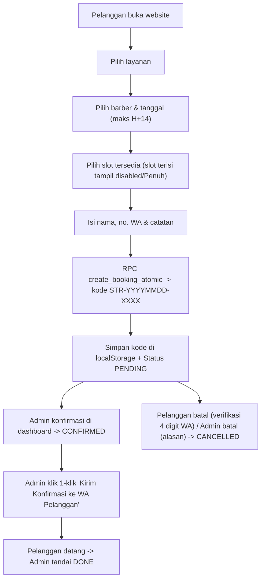

# Product Requirements Document (PRD)
# SETARA Barbershop — Website Booking Online

`MVP v1.0 — Implemented` `Next.js 14 + Supabase + Vercel` `Modern Clean Light UI`

PRD ini mencerminkan spesifikasi produk dan implementasi aktual website **SETARA Barbershop** (company profile, sistem booking slot online, dan dashboard admin). Dokumen ini menjadi acuan sinkron untuk operasional demo ke klien, pemeliharaan engineering, pengujian, maupun pengembangan lanjutan (v1.1). Asumsi atau item yang masih menunggu pengisian data final dari klien ditandai eksplisit dengan label `[PLACEHOLDER]`.

> **Catatan demo:** Sistem telah terhubung ke **Supabase PostgreSQL** dan siap demo. Logo (`logo.webp`), galeri (`Classic`, `Fade`, `Mid Fade`), profil barber (`Eko`, `Nuril`), lokasi Google Maps (`-8.165707, 113.4496112`), jadwal resmi, dan nomor WhatsApp (`0878-5769-7702`) sudah terpasang. Data layanan, bio/foto terpisah barber, dan alamat teks dapat diubah kapan saja melalui Dashboard Admin tanpa menyentuh kode.

---

## Ringkasan Produk

**Product concept**
Website company profile + sistem booking slot waktu online untuk **SETARA Barbershop**, memungkinkan pelanggan melihat layanan, memilih barber, memesan slot waktu yang tersedia (slot terisi tampil nonaktif), memantau status booking lewat kode unik, serta dilengkapi dashboard admin untuk mengelola layanan, barber, jadwal, booking, galeri, dan konten website.

| Parameter | Spesifikasi |
|-----------|-------------|
| **Target pengguna** | Pelanggan pria di sekitar SETARA Barbershop (`-8.165707, 113.4496112`) |
| **Konsep produk** | Company profile + online slot booking (guest booking tanpa login) |
| **Tahap pengembangan** | MVP v1.0 — Selesai diimplementasikan & siap demo lokal / deploy Vercel |
| **Desain & Tema** | Modern Clean Light (`#FAFAF8` bg, `#FFFFFF` surface, `#1C1C1C` charcoal, font `Plus Jakarta Sans`, ikon vektor `lucide-react` tanpa emoji) |
| **Model operasional** | Single operator, 2 barber (dapat ditambah oleh admin) |
| **Stack aktual** | Next.js 14.2 (App Router, TypeScript) + Supabase (PostgreSQL, Auth, Storage) + Tailwind CSS |
| **Platform** | Web responsif (teruji di `360px`, `768px`, `1920px`) |
| **Hosting target** | **Vercel (Hobby, free)** + **Supabase (Free tier)** |

---

## 1. Latar Belakang dan Masalah

### 1.1 Latar belakang
SETARA Barbershop melayani potong rambut pria dengan sistem operasional terjadwal. Sebelumnya proses booking dilakukan manual (datang langsung atau chat WhatsApp), sehingga pelanggan tidak mengetahui slot waktu yang tersedia, berisiko menunggu lama, dan rentan bentrok jadwal. Website ini memusatkan informasi layanan, lokasi Google Maps, ketersediaan slot per barber, dan pemesanan online dalam satu platform.

### 1.2 Problem statement
Pelanggan membutuhkan cara untuk:
- Melihat layanan, tarif, jam buka, dan lokasi Google Maps barbershop secara jelas.
- Memeriksa slot waktu per barber pada tanggal tertentu secara real-time (melihat mana yang tersedia dan mana yang sudah penuh).
- Memilih barber tertentu sesuai kecocokan.
- Melakukan booking tanpa perlu membuat akun, mendapatkan kode booking unik, dan menyimpan/menyalin kode dengan mudah.
- Mengecek status konfirmasi booking atau membatalkan booking `PENDING` secara mandiri.

Pengelola membutuhkan cara untuk:
- Mengelola layanan, harga, dan status aktif/nonaktif layanan.
- Mengelola profil barber serta jadwal kerja & jam istirahat per barber per hari.
- Memproses booking masuk (`Konfirmasi`, `Tandai Selesai`, `Batalkan` dengan alasan) dan langsung mengabari pelanggan via WhatsApp 1-klik.
- Mengelola galeri foto, identitas bisnis, kontak, jam operasional, dan link lokasi tanpa menyentuh kode.

### 1.3 Tujuan produk
- Menyediakan website company profile yang cepat, bersih, dan responsif untuk SETARA Barbershop.
- Menyediakan sistem booking slot waktu per barber dengan jaminan 0 double-booking di level database.
- Menyediakan dashboard admin lengkap untuk pengelolaan operasional harian dan konten.
- Menyediakan halaman cek status booking via kode unik dengan dukungan riwayat kode lokal perangkat.

### 1.4 Batasan produk (tidak masuk MVP v1.0)
- **Tidak ada akun pelanggan** — booking sebagai guest menggunakan kode booking (`STR-YYYYMMDD-XXXX`).
- **Tidak ada payment gateway online** — pembayaran di tempat setelah selesai layanan.
- **Tidak ada layanan selain potong rambut** — cukur jenggot, coloring, dll. direncanakan di v1.1.
- **Tidak ada WhatsApp Business API otomatis** — menggunakan tautan `wa.me` 1-klik (baik dari pelanggan ke admin maupun dari admin ke pelanggan) dengan pesan terisi otomatis.
- **Tidak ada aplikasi native iOS/Android** — fokus web responsif.
- **Tidak ada multi-bahasa** — Bahasa Indonesia saja.
- **Tidak ada multi-cabang** — single cabang.
- **Tidak ada fitur loyalty/poin atau laporan keuangan kompleks** — hanya ringkasan jumlah booking di dashboard.

---

## 2. Pengguna, Role, dan Hak Akses

| Role | Tanggung jawab |
|------|----------------|
| **Pelanggan / Guest (publik)** | Menjelajahi website, melihat layanan, galeri & lokasi, memilih barber & slot waktu, melakukan booking, mengecek status booking via kode, dan membatalkan booking `PENDING`. |
| **Admin / Owner** | Mengelola layanan, barber, jadwal, booking (konfirmasi/selesai/batal + kabari WA), galeri, konten, dan pengaturan website. |

**Aturan otorisasi:**
- Guest **tidak perlu login** dan **tidak dapat mengakses tabel `bookings` secara langsung** melalui Supabase `anon` key (ditutup oleh RLS).
- Semua aksi guest (`availability`, `booking`, `check-booking`, `cancel`) melewati Next.js Route Handler (`/api/*`) + Supabase `SECURITY DEFINER` RPC / Service Role dengan masking nomor telepon pada respons cek status.
- Admin wajib login via Supabase Auth (`/login`, email + password) dan harus terdaftar di tabel `public.admin_users`.
- Middleware (`middleware.ts` → `lib/supabase/middleware.ts`) melindungi `/admin/*` dan `/login`, serta melewati pengecekan sesi untuk rute publik agar respons halaman publik cepat.
- Seluruh API admin (`/api/admin/*`) memvalidasi sesi dan keanggotaan `admin_users` melalui `requireAdminUser()`.

---

## 3. Ruang Lingkup dan Fitur Fungsional

### 3.1 Halaman Publik

#### FR-01 — Homepage (`/`)
Menampilkan navbar & footer dengan logo (`settings.logo_url`) dan favicon (`public/images/logo.webp`), hero section (nama barbershop, tagline, tombol "Booking Sekarang" & "Cek Status Booking"), daftar layanan aktif (dari DB), profil singkat barber aktif (`Eko` & `Nuril` dari DB), preview galeri (hingga 6 item foto/video dengan lightbox), tabel jam operasional (WIB), serta kartu lokasi & kontak lengkap dengan tombol **Chat WhatsApp**, **Buka di Maps**, **Petunjuk Arah**, dan **Google Maps embed ber-pin penanda lokasi SETARA Barbershop**.
**Prioritas:** P0 (Selesai)

#### FR-02 — Tentang Kami (`/about`)
Halaman profil barbershop yang mengambil konten `business_name`, `tagline`, dan `about_description` dari tabel `settings` (dapat diedit admin).
**Prioritas:** P0 (Selesai)

#### FR-03 — Daftar Layanan (`/services`)
Menampilkan kartu layanan aktif dari tabel `services`: nama, deskripsi, harga (IDR), durasi slot acuan (`settings.slot_duration_minutes`), dan tombol **Booking** menuju `/booking/[serviceId]`.
**Prioritas:** P0 (Selesai)

#### FR-04 — Pilih Barber (`/booking` & `/booking/[serviceId]`)
Menampilkan daftar barber aktif (`barbers` dengan `is_active = true`: foto, nama, bio singkat). Pelanggan memilih layanan lalu memilih barber sebelum memilih tanggal dan slot waktu. Mendukung query `?barberId=...`.
**Prioritas:** P0 (Selesai)

#### FR-05 — Galeri (`/gallery`)
Grid foto dan video MP4 dari tabel `galleries` terurut berdasarkan `sort_order`, dilengkapi modal **lightbox** (menampilkan player `<video>` untuk `.mp4` dan tampilan gambar penuh untuk foto) serta badge indikator `Video` pada item MP4.
**Prioritas:** P0 (Selesai)

#### FR-06 — Lokasi & Kontak (`/contact`)
Menampilkan alamat lengkap, nomor WhatsApp admin (`wa.me` dengan pesan pembuka otomatis), jam operasional (WIB), Google Maps embed iframe dengan pin merah lokasi **SETARA BARBERSHOP** (`-8.165707, 113.4496112`), tombol **Buka di Google Maps**, serta tombol **Petunjuk Arah** (otomatis mengekstrak koordinat pin `!3d...!4d...` atau `@lat,lng` untuk navigasi langsung).
**Prioritas:** P0 (Selesai)

### 3.2 Sistem Booking

#### FR-07 — Pilih Slot Waktu (`/booking/[serviceId]`)
Setelah memilih layanan dan barber, pelanggan memilih tanggal (hari ini s/d `H+14` zona waktu WIB / `Asia/Jakarta`). Sistem memanggil `GET /api/availability`:
- Hari tutup global (`Senin`), hari libur barber, slot di luar jam operasional/jadwal barber, slot pada jam istirahat barber (jika diatur), serta slot yang sudah lewat atau `< 30 menit` sebelum waktu mulai **tidak ditampilkan**.
- **Slot yang sudah dibooking (`PENDING` atau `CONFIRMED`) tetap ditampilkan sebagai tombol nonaktif (`disabled`, teks tercoret dengan label `Penuh`) sehingga tidak dapat diklik**.
- Jika seluruh slot pada tanggal tersebut sudah terisi penuh, tampilkan pesan pemberitahuan yang jelas.
- Jadwal resmi & grid slot 40 menit:
  - **Selasa–Kamis, Sabtu–Minggu (`11:00–21:00`):** 15 slot mulai `11:00` s/d `20:20` (slot terakhir selesai pukul `21:00`).
  - **Jumat (`13:00–21:00`):** 12 slot mulai `13:00` s/d `20:20` (slot terakhir selesai pukul `21:00`).
  - **Senin:** Tutup.
**Prioritas:** P0 (Selesai)

#### FR-08 — Form Data Pemesan
Input: nama lengkap (2–100 karakter), nomor WhatsApp Indonesia valid (dinormalisasi ke format `628...`), dan catatan tambahan (opsional, maks 500 karakter). Validasi dilakukan server-side termasuk pembatasan maksimal **2 booking `PENDING` aktif** per nomor WhatsApp dan rate limit **10 request/menit** per IP.
**Prioritas:** P0 (Selesai)

#### FR-09 — Ringkasan & Konfirmasi Booking (`/booking/confirmation?code=...`)
Menampilkan kode booking unik (`STR-YYYYMMDD-XXXX`), badge status, tombol **Salin Kode** (clipboard), detail pemesan, layanan, barber, tanggal, waktu WIB, catatan, dan total bayar di tempat. Halaman aman di-refresh karena memuat data berdasarkan query `?code=...`. Kode booking otomatis disimpan ke `localStorage` browser pelanggan (`setara_recent_booking_codes`, maks 5 terakhir), disertai tombol **Konfirmasi via WhatsApp Admin** (pesan otomatis terisi) dan tombol **Cek Status Booking**.
**Prioritas:** P0 (Selesai)

#### FR-10 — Cek Status Booking (`/check-booking`)
Halaman publik untuk input kode booking (atau langsung lewat `?code=...` maupun chip **"Booking terakhir di perangkat ini"** dari `localStorage`). Menampilkan detail booking dengan nomor WhatsApp termasking (`6281****7890`), status terkini, tombol **Hubungi WhatsApp Admin**, dan tombol **Batalkan Booking** (khusus status `PENDING`, melalui modal verifikasi **4 digit terakhir nomor WhatsApp** pemesan + alasan opsional).
**Prioritas:** P0 (Selesai)

### 3.3 Dashboard Admin (`/admin/*`)

#### FR-11 — Autentikasi Admin (`/login`)
Login email + password menggunakan Supabase Auth, proteksi middleware + `requireAdminUser()`, session cookies SSR, dan tombol Logout di sidebar admin.
**Prioritas:** P0 (Selesai)

#### FR-12 — Dashboard Utama (`/admin`)
Menampilkan 5 widget ringkasan real-time: **Booking Hari Ini** (WIB), **Menunggu Konfirmasi (`pending`)**, **Terkonfirmasi (`confirmed`)**, **Selesai (`done`)**, dan **Total Bulan Ini**, serta tabel **8 Booking Terbaru**.
**Prioritas:** P0 (Selesai)

#### FR-13 — Manajemen Layanan (`/admin/services`)
CRUD layanan: nama, deskripsi, harga (IDR integer), durasi referensi (menit, default 40 untuk persiapan v1.1), dan status aktif/nonaktif. Layanan yang sudah memiliki riwayat booking dilindungi `ON DELETE RESTRICT` (disarankan nonaktif daripada hapus).
**Prioritas:** P0 (Selesai)

#### FR-14 — Manajemen Barber (`/admin/barbers`)
CRUD barber: nama, bio, upload foto ke Supabase Storage bucket `barbershop-media` (`JPG`, `PNG`, `WebP` maks 5MB) atau input URL, dan status aktif/nonaktif. Penambahan barber baru otomatis menginisialisasi jadwal default 7 hari (`barber_schedules`).
**Prioritas:** P0 (Selesai)

#### FR-15 — Manajemen Jadwal Barber (`/admin/schedules`)
Pengaturan jam kerja per barber per hari (Senin–Minggu), toggle masuk/libur, jam mulai/selesai, serta jam istirahat opsional (`break_start`, `break_end`). Hari tutup global di `settings` tetap meng-override jadwal barber.
**Prioritas:** P0 (Selesai)

#### FR-16 — Manajemen Booking (`/admin/bookings`)
Daftar booking dengan filter **tanggal**, **status**, **barber**, dan **pencarian kode booking**. Modal detail menampilkan data pemesan, riwayat audit `booking_status_logs`, aksi transisi status (**Konfirmasi Booking**, **Tandai Selesai**, **Batalkan Booking** dengan alasan wajib), serta **tombol 1-klik "Kirim Konfirmasi ke WA Pelanggan"** / **"Kabari Pembatalan via WA"** yang otomatis mengisi pesan detail booking beserta link `/check-booking?code=...`.
**Prioritas:** P0 (Selesai)

#### FR-17 — Manajemen Galeri (`/admin/gallery`)
Upload foto atau video ke Supabase Storage (`barbershop-media`, format `JPG`, `PNG`, `WebP`, `MP4` maks 5MB) atau URL media, preview langsung gambar/video, edit caption, atur `sort_order`, dan hapus item galeri.
**Prioritas:** P0 (Selesai)

#### FR-18 & FR-19 — Manajemen Konten & Pengaturan (`/admin/settings`)
Pengaturan terpusat pada tabel `settings`:
- Identitas & konten (`business_name`, `tagline`, `logo_url` dengan upload langsung `JPG/PNG/WebP`, `about_description`).
- Lokasi & kontak (`whatsapp_number`, `address`, `google_maps_link`, `google_maps_embed_url`).
- Aturan booking (`slot_duration_minutes`, `booking_min_lead_minutes`, `booking_max_days_ahead`, `max_pending_per_phone`).
- Jadwal operasional toko per hari (`operating_hours` JSON & `closed_days` JSON array).
**Prioritas:** P0 (Selesai)

### 3.4 Alur Booking & Notifikasi Utama



---

## 4. Business Rules

| ID | Aturan Bisnis |
|----|---------------|
| **BR-01** | Hanya layanan & barber berstatus `is_active = true` yang ditampilkan di publik dan dapat dibooking. |
| **BR-02** | Semua harga disimpan dalam Rupiah (IDR), integer `>= 0`. |
| **BR-03** | Durasi grid slot mengacu pada `settings.slot_duration_minutes` (default `40` menit). `services.duration_minutes` disimpan untuk referensi v1.1. |
| **BR-04** | Pengecekan ketersediaan & pembuatan booking berjalan atomik dalam PostgreSQL RPC `create_booking_atomic` (mengunci baris `barbers` dengan `SELECT ... FOR UPDATE`) + **Partial Unique Index** `uniq_bookings_active_slot` pada `(barber_id, booking_date, start_time) WHERE status IN ('pending', 'confirmed')`. |
| **BR-05** | Slot dengan status `pending` atau `confirmed` memblokir slot dan tampil sebagai tombol nonaktif (`Penuh`) di UI. Satu nomor WhatsApp dibatasi maksimal `2` booking berstatus `pending` aktif secara bersamaan. |
| **BR-06** | Slot pada hari tutup, di luar jam operasional toko/jadwal barber, di dalam jam istirahat barber, slot lewat / `< 30 menit` sebelum waktu mulai, dan tanggal `> H+14` (zona waktu `Asia/Jakarta` / WIB) tidak ditampilkan. Hanya slot dengan `end_time <= close_time` yang valid. |
| **BR-07** | Booking baru selalu berstatus `pending`. Admin konfirmasi → `confirmed`. |
| **BR-08** | Admin menandai selesai → `done`. |
| **BR-09** | Pelanggan dapat membatalkan booking `pending` via `/check-booking` dengan verifikasi 4 digit terakhir nomor WhatsApp pemesan (`cancel_booking_by_guest`). |
| **BR-10** | Admin dapat membatalkan booking `pending` atau `confirmed` dengan alasan tertulis wajib (`update_booking_status_admin`). |
| **BR-11** | Setiap pembuatan dan perubahan status booking wajib tercatat di `booking_status_logs`. |
| **BR-12** | Kode booking berformat `STR-YYYYMMDD-XXXX` (4 karakter alfanumerik aman tanpa `0/O/I/1`), dijamin `UNIQUE`. |
| **BR-13** | Jadwal operasional & slot 40 menit default: **Senin** tutup; **Selasa–Kamis & Sabtu–Minggu** `11:00–21:00` (15 slot: `11:00` s/d `20:20`); **Jumat** `13:00–21:00` (12 slot: `13:00` s/d `20:20`). |
| **BR-14** | Hierarki jadwal: Hari tutup global (`settings.closed_days`) meng-override seluruh jadwal barber. Di hari buka, slot berada pada irisan `settings.operating_hours` dan `barber_schedules`. |
| **BR-15** | Harga diambil dari `services.price` di backend saat transaksi dan disimpan permanen pada `bookings.price_snapshot`. |

### 4.1 Siklus Status Booking
```text
(baru)  → PENDING
PENDING → CONFIRMED → DONE
PENDING → CANCELLED (pelanggan via verifikasi 4 digit WA / admin dengan alasan)
CONFIRMED → CANCELLED (admin dengan alasan)
```

---

## 5. Acceptance Criteria

- **AC-01 — Pilih Slot & Tampilan Slot Terisi:** Pelanggan dapat memilih layanan, barber, tanggal (maks `H+14`), dan slot waktu WIB. Slot yang sudah dibooking tampil nonaktif (`Penuh`, tidak bisa diklik). Slot di luar jam operasional, hari tutup (`Senin`), yang sudah lewat / `< 30 menit` sebelum mulai, atau menabrak jam istirahat tidak ditampilkan.
- **AC-02 — Anti Double-Booking:** Dua request paralel pada slot yang sama → tepat satu berhasil (`201`), yang kedua ditolak (`409` dengan pesan `"Slot tidak tersedia..."`). Status `cancelled` & `done` otomatis membuka kembali slot tersebut.
- **AC-03 — Pembuatan Booking:** Booking berhasil menghasilkan kode unik `STR-YYYYMMDD-XXXX`, status awal `pending`, `price_snapshot` dihitung backend, dan tersimpan di `localStorage` perangkat.
- **AC-04 — Cek Status & Pembatalan Guest:** Input kode valid menampilkan detail booking dengan nomor WhatsApp termasking. Pembatalan `pending` hanya berhasil jika 4 digit terakhir nomor WhatsApp cocok (`403` jika salah). Kode tidak valid menampilkan pesan error umum tanpa membocorkan data.
- **AC-05 — Keamanan & Otorisasi:** Route `/admin/*` tanpa sesi admin me-redirect ke `/login`. Route `/api/admin/*` tanpa sesi mengembalikan `401 Unauthorized`. Akses langsung `anon` ke tabel `bookings` ditolak oleh RLS.
- **AC-06 — Audit Trail:** Semua transisi status booking tercatat di `booking_status_logs` (`actor_type`, `actor_id`, `from_status`, `to_status`, `note`, `created_at`).
- **AC-07 — Responsif:** Website optimal dan bebas horizontal scroll pada viewport `360px` (mobile), `768px` (tablet), dan `1920px` (desktop).

---

## 6. Arsitektur Teknis

- **Pola:** Next.js 14 App Router (fullstack) + Supabase (PostgreSQL, Auth, Storage).
- **Presentation:** Next.js 14 App Router + Tailwind CSS + `lucide-react` (komponen UI ringan custom tanpa emoticon/emoji).
- **Caching & Performa:** `middleware.ts` hanya menjalankan verifikasi Supabase Auth pada `/admin/*` dan `/login` (rute publik tidak terkena round-trip auth). Query server katalog (`settings`, `services`, `barbers`, `galleries`) dideduplikasi per render melalui `React.cache`.
- **API:** Route Handlers (`app/api/*`) untuk availability, booking, check-booking, upload media, dan CRUD admin.
- **Database & Security:** Supabase PostgreSQL + RLS + `SECURITY DEFINER` RPC functions.
- **Testing:** Vitest (unit & mocked API concurrency/auth tests) + Playwright (E2E responsive & auth redirect tests).

### 6.1 Modul dan Tanggung Jawab

| Modul | Tanggung jawab |
|-------|----------------|
| `Auth` | Login/logout admin, proteksi route `/admin/*` & API admin, verifikasi `admin_users`. |
| `Catalog` | Query publik & CRUD admin untuk layanan, barber, galeri, dan konten. |
| `Schedule` | Jadwal barber, jam operasional per hari, hari tutup, generator slot deterministik (`slot-generator.ts`) & `availability-service.ts`. |
| `Booking` | Pembuatan booking atomik (`create_booking_atomic`), cek status termasking, pembatalan guest (`cancel_booking_by_guest`), update status admin (`update_booking_status_admin`), dan log audit. |
| `Settings` | Pembacaan & pembaruan konfigurasi bisnis (`settings-service.ts`, `lib/utils/settings.ts`). |

### 6.2 Stack Aktual

| Komponen | Implementasi |
|----------|--------------|
| **Framework** | Next.js `14.2.x` (App Router, TypeScript) |
| **Database & Storage** | Supabase (PostgreSQL + Storage bucket `barbershop-media`) |
| **Auth** | Supabase Auth (`@supabase/ssr`) |
| **Styling & Icons** | Tailwind CSS `3.4.x` + `lucide-react` |
| **Testing** | Vitest + Playwright |
| **Script Operasional** | `pg` & `@supabase/supabase-js` (`migrate-db.mjs`, `seed-admin.mjs`, `verify-supabase.mjs`, `reset-demo.mjs`) |
| **Hosting target** | Vercel (Hobby, free) + Supabase (Free tier) |

### 6.3 Struktur Folder Aktual

```text
├── middleware.ts
├── playwright.config.ts
├── vitest.config.ts
├── app/
│   ├── layout.tsx
│   ├── globals.css
│   ├── error.tsx
│   ├── (public)/
│   │   ├── layout.tsx
│   │   ├── page.tsx                        # Homepage + Peta Google Maps ber-pin
│   │   ├── about/page.tsx
│   │   ├── services/page.tsx
│   │   ├── gallery/page.tsx
│   │   ├── contact/page.tsx                # Alamat, WA, Jam, Google Maps + Petunjuk Arah
│   │   ├── booking/
│   │   │   ├── page.tsx                    # Pilih layanan
│   │   │   ├── [serviceId]/page.tsx        # Pilih barber, tanggal & slot
│   │   │   └── confirmation/page.tsx       # Ringkasan, salin kode & WA admin
│   │   └── check-booking/page.tsx          # Cek status, riwayat lokal & batal guest
│   ├── (admin)/
│   │   ├── login/page.tsx
│   │   └── admin/
│   │       ├── layout.tsx                  # Sidebar admin terproteksi
│   │       ├── page.tsx                    # Dashboard 5 widget + booking terbaru
│   │       ├── services/page.tsx
│   │       ├── barbers/page.tsx
│   │       ├── schedules/page.tsx
│   │       ├── bookings/page.tsx           # Filter, detail, audit log & 1-klik WA pelanggan
│   │       ├── gallery/page.tsx
│   │       └── settings/page.tsx
│   └── api/
│       ├── availability/route.ts
│       ├── booking/route.ts
│       ├── check-booking/route.ts
│       └── admin/
│           ├── services/route.ts & [id]/route.ts
│           ├── barbers/route.ts & [id]/route.ts
│           ├── schedules/route.ts
│           ├── bookings/route.ts & [id]/route.ts
│           ├── gallery/route.ts & [id]/route.ts
│           ├── settings/route.ts
│           └── upload/route.ts
├── components/
│   ├── admin/AdminSidebar.tsx
│   ├── booking/
│   │   ├── BookingConfirmationActions.tsx
│   │   ├── BookingSlotForm.tsx
│   │   └── CheckBookingClient.tsx
│   ├── public/
│   │   ├── Footer.tsx
│   │   ├── GalleryGrid.tsx
│   │   └── Navbar.tsx
│   └── ui/StatusBadge.tsx
├── lib/
│   ├── supabase/ (client.ts, server.ts, admin.ts, middleware.ts)
│   ├── services/ (availability-service.ts, booking-service.ts, catalog-service.ts, settings-service.ts, slot-generator.ts)
│   └── utils/ (format.ts, rate-limit.ts, recent-bookings.ts, settings.ts)
├── public/images/ (logo.webp, placeholder-gallery-1..3.svg)
├── scripts/ (migrate-db.mjs, seed-admin.mjs, verify-supabase.mjs, reset-demo.mjs)
├── supabase/
│   ├── migrations/ (001_initial_schema.sql, 002_rls_policies.sql, 003_booking_rpc.sql)
│   └── seed.sql
├── tests/
│   ├── slot-generator.test.ts
│   ├── booking-utils.test.ts
│   ├── api-auth-concurrency.test.ts
│   └── e2e/smoke.spec.ts
└── types/index.ts
```

---

## 7. Rancangan Database & Integritas Data

### 7.1 Entitas Utama (8 Tabel)
1. `admin_users`: `id (uuid PK -> auth.users)`, `email (unique)`, `created_at`
2. `services`: `id (uuid PK)`, `name`, `description`, `price (int)`, `duration_minutes (int, default 40)`, `is_active (bool)`, `created_at`, `updated_at`
3. `barbers`: `id (uuid PK)`, `name`, `bio`, `photo_url (nullable)`, `is_active (bool)`, `created_at`, `updated_at`
4. `barber_schedules`: `id (uuid PK)`, `barber_id (FK -> barbers ON DELETE CASCADE)`, `day_of_week (0–6, 0=Senin)`, `start_time`, `end_time`, `break_start (nullable)`, `break_end (nullable)`, `is_working (bool)`, `created_at`, `updated_at`, `UNIQUE(barber_id, day_of_week)`
5. `bookings`: `id (uuid PK)`, `booking_code (unique)`, `service_id (FK RESTRICT)`, `barber_id (FK RESTRICT)`, `guest_name`, `guest_phone`, `booking_date`, `start_time`, `end_time`, `price_snapshot (int)`, `status (enum booking_status)`, `notes (nullable)`, `created_at`, `updated_at`
6. `booking_status_logs`: `id (uuid PK)`, `booking_id (FK CASCADE)`, `actor_type (enum actor_type_enum)`, `actor_id (nullable)`, `from_status (nullable)`, `to_status`, `note (nullable)`, `created_at`
7. `galleries`: `id (uuid PK)`, `title (nullable)`, `image_url`, `sort_order (int)`, `created_at`
8. `settings`: `id (uuid PK)`, `key (unique)`, `value (text)`, `type (string|text|int|bool|json)`, `group`, `created_at`, `updated_at`

### 7.2 Kunci `settings` Aktual
- `business_name`, `tagline`, `logo_url`, `about_description`
- `address`, `whatsapp_number`, `google_maps_embed_url` (ber-pin `-8.165707, 113.4496112`), `google_maps_link`
- `slot_duration_minutes` (`40`), `timezone` (`Asia/Jakarta`), `booking_min_lead_minutes` (`30`), `booking_max_days_ahead` (`14`), `max_pending_per_phone` (`2`)
- `closed_days` (`[0]`), `operating_hours` (JSON jadwal Senin–Minggu)

### 7.3 Anti Double-Booking, RLS & Storage
- **Partial Unique Index:** `uniq_bookings_active_slot ON bookings(barber_id, booking_date, start_time) WHERE status IN ('pending', 'confirmed')`.
- **RPC Atomik (`003_booking_rpc.sql`):**
  - `create_booking_atomic`: mengunci baris `barbers` (`FOR UPDATE`), validasi hari tutup/jadwal/istirahat/lead time/max H+14/max pending per WA, generate kode unik, insert `bookings` + `booking_status_logs`.
  - `cancel_booking_by_guest`: validasi status `pending` + kecocokan 4 digit terakhir `guest_phone`.
  - `update_booking_status_admin`: validasi keanggotaan `admin_users`, transisi status, alasan wajib jika `cancelled`, dan log audit.
- **RLS (`002_rls_policies.sql`):** `bookings` & `booking_status_logs` tertutup penuh untuk akses langsung `anon`; `barbershop-media` bucket membatasi file maks 5MB (`image/jpeg`, `image/png`, `image/webp`, `video/mp4`).

---

## 8. Backlog & Status Implementasi

| ID | Epic / Task | Prioritas | Status |
|----|-------------|-----------|--------|
| **BK-01** | Setup Next.js 14 + Tailwind CSS + TypeScript + Supabase | P0 | Selesai |
| **BK-02** | Migrasi 8 tabel + RLS + RPC atomik + Storage bucket + Seed | P0 | Selesai (`migrate-db.mjs`) |
| **BK-03** | Auth admin (login/logout, middleware, `requireAdminUser`) | P0 | Selesai (`seed-admin.mjs`) |
| **BK-04** | CRUD layanan | P0 | Selesai |
| **BK-05** | CRUD barber + inisialisasi jadwal 7 hari | P0 | Selesai |
| **BK-06** | CRUD jadwal barber + slot generator WIB (`disabled` untuk slot penuh) | P0 | Selesai |
| **BK-07** | CRUD galeri + upload Storage + urutan foto | P0 | Selesai |
| **BK-08** | Halaman publik: beranda + peta pin Maps, tentang, layanan, galeri, kontak | P0 | Selesai |
| **BK-09** | API availability (`/api/availability`) | P0 | Selesai |
| **BK-10** | Booking service atomik (`create_booking_atomic`) + rate limit | P0 | Selesai |
| **BK-11** | Form pemesan + ringkasan + salin kode + simpan kode di `localStorage` | P0 | Selesai |
| **BK-12** | Halaman cek status + chip riwayat perangkat + pembatalan 4 digit WA | P0 | Selesai |
| **BK-13** | Dashboard admin: 5 widget ringkasan + booking terbaru | P0 | Selesai |
| **BK-14** | Manajemen booking admin + filter + modal detail + 1-klik WA pelanggan | P0 | Selesai |
| **BK-15** | Manajemen konten & settings (termasuk jam per hari, hari tutup, Maps) | P0 | Selesai |
| **BK-16** | Audit log `booking_status_logs` di semua transisi | P0 | Selesai |
| **BK-17** | Tombol WA pelanggan → admin & admin → pelanggan | P0 | Selesai |
| **BK-18** | Optimasi responsif (`360px`–`1920px`) & performa (`React.cache` + middleware skip) | P0 | Selesai |
| **BK-19** | Automated tests: Vitest (15 tests), Playwright E2E (5 tests), & live Supabase concurrency (`verify:supabase`) | P0 | Selesai |
| **BK-20** | Seed data placeholder + script reset demo (`reset-demo.mjs`) | P0 | Selesai |
| **BK-21** | Deploy ke Vercel + hubungkan env vars produksi | P0 | Siap Deploy |

---

## 9. Non-Functional Requirements

| ID | Requirement | Kriteria & Implementasi |
|----|-------------|-------------------------|
| **NFR-01** | Security | Supabase Auth; validasi server-side; RLS aktif; `bookings` tertutup bagi `anon`; rate limit API booking (10 req/menit); maks 2 `pending` per nomor WA; verifikasi 4 digit terakhir WA untuk batal guest. |
| **NFR-02** | Data consistency | Booking & log status atomik via PostgreSQL RPC + Partial Unique Index `uniq_bookings_active_slot`. |
| **NFR-03** | Latency | Middleware melewati cek Auth pada rute publik; deduplikasi query via `React.cache`; mode produksi lokal terukur < 200ms pada halaman kontak. |
| **NFR-04** | Responsiveness | Bebas horizontal scroll pada `360px`, `768px`, dan `1920px` (terverifikasi Playwright E2E). |
| **NFR-05** | Reliability | Rollback otomatis pada transaksi RPC PostgreSQL; error boundary Next.js (`app/error.tsx`). |
| **NFR-06** | File upload | Validasi server-side & Storage bucket maks 5MB, MIME `image/jpeg`, `image/png`, `image/webp`, dan `video/mp4` (untuk galeri video). |

---

## 10. Status Data Placeholder `[PLACEHOLDER]` & Persiapan Produksi

Sudah final di sistem & database:
- **Jadwal operasional & hari tutup:** Senin tutup; Selasa–Kamis & Sabtu–Minggu `11:00–21:00`; Jumat `13:00–21:00` (WIB / `Asia/Jakarta`).
- **Durasi slot default:** `40` menit (`settings.slot_duration_minutes`), lead time `30` menit, maksimal `H+14`.
- **Lokasi & Google Maps pin:** Koordinat `-8.165707, 113.4496112` (**SETARA BARBERSHOP**) beserta embed iframe & tombol Petunjuk Arah.
- **Nomor WhatsApp Admin:** `6287857697702` (`0878-5769-7702`).
- **Logo & Favicon:** `logo.webp` terpasang di Navbar, Footer, dan icon tab browser (`public/images/logo.webp` + `settings.logo_url`).
- **Barber aktif:** `Eko` dan `Nuril` (menggunakan foto profil sementara dari `foto.jpg`).
- **Galeri aktif:** 3 item (`Classic` video `.mp4`, `Fade` video `.mp4`, dan `Mid Fade` `.webp`).

Masih `[PLACEHOLDER]` (isi/ubah via Dashboard Admin sebelum launching penuh):
- Foto profil terpisah untuk `Eko` dan `Nuril` serta bio masing-masing.
- Nama, deskripsi, dan tarif final layanan (`Potong Rambut Pria`, Rp 30.000).
- Alamat teks lengkap barbershop.
- Ganti password admin default & rotasi `SUPABASE_SERVICE_ROLE_KEY` bila diperlukan sebelum go-live.

---

## 11. Definition of Done (DoD)
- [x] Pelanggan dapat menjelajahi beranda, tentang, layanan, galeri (lightbox), dan kontak (Google Maps ber-pin + Petunjuk Arah).
- [x] Pelanggan dapat memilih layanan → barber → tanggal → slot (slot terisi tampil nonaktif `Penuh`).
- [x] Pelanggan dapat menyelesaikan booking, menyalin kode unik, menyimpannya di browser, dan cek status via `/check-booking`.
- [x] Uji concurrency 2 request paralel terjamin 0 double-booking (terverifikasi via mocked API test & live `npm run verify:supabase`).
- [x] Admin dapat login, melihat 5 widget dashboard, mengelola layanan/barber/jadwal/galeri/settings, memproses status booking dengan audit log, dan mengabari pelanggan via tombol WA 1-klik.
- [x] Seluruh unit test Vitest (`15/15`), lint, production build, dan E2E Playwright (`5/5` di `360px`, `768px`, `1920px`) lulus.
- [ ] Push ke GitHub & deploy demo ke Vercel dengan 3 environment variables Supabase.

**Kesimpulan:** PRD SETARA Barbershop v1.0 telah diselaraskan sepenuhnya dengan implementasi aktual di repository, database Supabase live, aturan slot disabled (`Penuh`), peta Google Maps ber-pin lokasi SETARA Barbershop, optimasi performa publik, alur konfirmasi WhatsApp 1-klik + `localStorage` kode booking, serta seluruh hasil pengujian otomatis.
